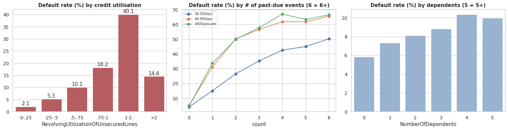
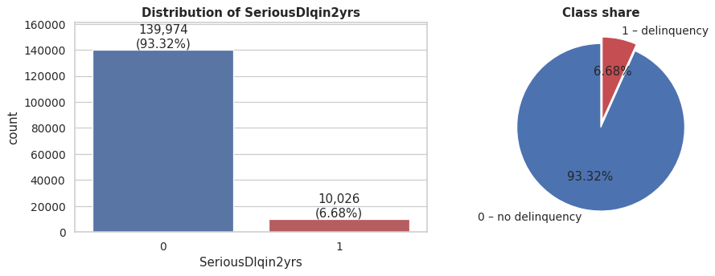
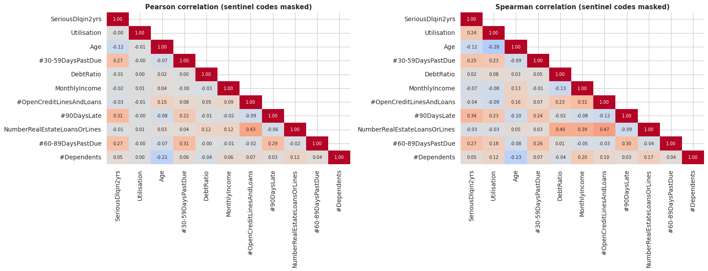

# Credit Score Dataset: EDA & Data Quality Assessment

A complete exploratory data analysis and data-quality audit of **150,000 borrowers** (13 variables). The target is `SeriousDlqin2yrs`: 90+ days past due within 2 years.

The aim is to find every problem in the raw data, explain it, and clean it with a justified decision for each, so the dataset is safe to use for credit-risk modelling.

**Notebook:** [`Credit_Score_EDA.ipynb`](Credit_Score_EDA.ipynb) · **Rendered report:** [`Credit_Score_EDA.html`](Credit_Score_EDA.html)



## Key data-quality findings
1. **Placeholder codes 96/98** appear in all three past-due counters (269 rows, 54.6% default rate). Read as counts, they would badly distort any model.
2. **`DebtRatio` isn't a ratio when income is missing or zero.** For those borrowers the median is about 1,000, against 0.29 for borrowers with valid income. These values are dollar amounts.
3. **`MonthlyIncome`:** about 20% missing plus 1,634 zeros. The missingness carries information: it has its own default rate.
4. **`Gender` is 99.8% empty and not missing at random.** It only appears in the first ~16k IDs.
5. **Impossible or extreme values:** `Age = 0`, utilisation up to 50,708, and income up to about 3M.

## Key EDA insights
- **Heavy class imbalance:** only **6.68%** defaulted (about 14:1), so accuracy is a misleading metric.
- **Past-due history is the strongest predictor.** One 90-day delinquency raises default from 4.6% to 34%.
- **Credit utilisation:** about 2% default below 25% utilisation, rising to about **40%** for borrowers over their limit.
- **Age:** younger borrowers are riskier, about 11% under 36 against about 2% over 65.
- **Spearman beats Pearson here.** Pearson is close to 0 for the skewed variables, while rank correlation reveals the real relationships.

## Cleaning decisions
| Problem | Decision |
|---|---|
| Gender | Standardised, then dropped (unusable and a sensitive attribute) |
| Age = 0 | 1 row removed |
| 96/98 codes | Set to NaN, median-imputed, and a `LateCodeFlag` added to keep the signal |
| Missing/zero income | `IncomeUnknown` flag plus the median income for the borrower's age band |
| Outliers | Capped (winsorised), not removed, so no defaulters are lost; `UtilOver1` flag added |
| Duplicates | 0 exact duplicates; 608 rows with identical features were investigated and kept |

**Result:** skewness of utilisation, DebtRatio and income falls from about **95–114 to 1–4**. Only 1 of 150,000 rows is removed, and the target distribution is unchanged.

| Target distribution | Correlation heatmap |
|---|---|
|  |  |

## Data
The raw `CreditScore.csv` (≈7.7 MB) isn't included. The variables match Kaggle's public **"Give Me Some Credit"** dataset, with a `Gender` column added by the course. To run the notebook, place `CreditScore.csv` in the repo root. The variable definitions are in `data/Data Dictionary.xls`.

## Run it
```bash
pip install -r requirements.txt
jupyter notebook Credit_Score_EDA.ipynb
```

## Tech
Python · pandas · NumPy · Matplotlib · Seaborn

*Built as part of the NAVTTC / NETSOL Institute of AI, AI/ML & Deep Learning program (2026).*
